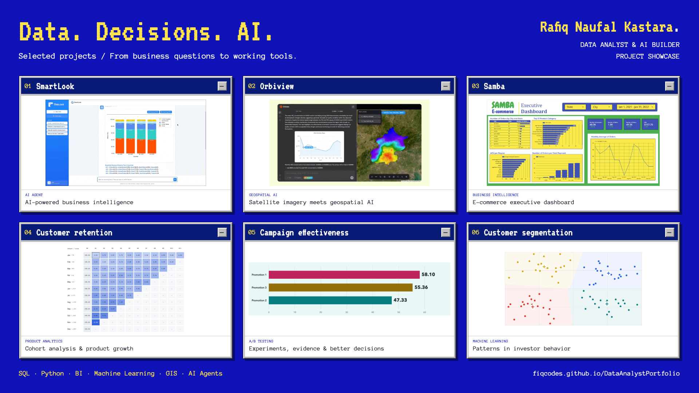
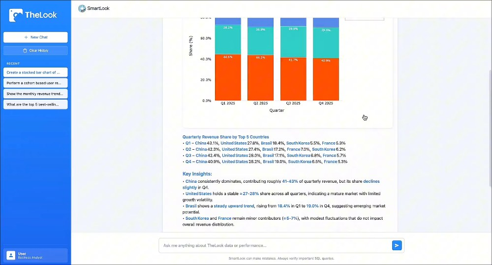
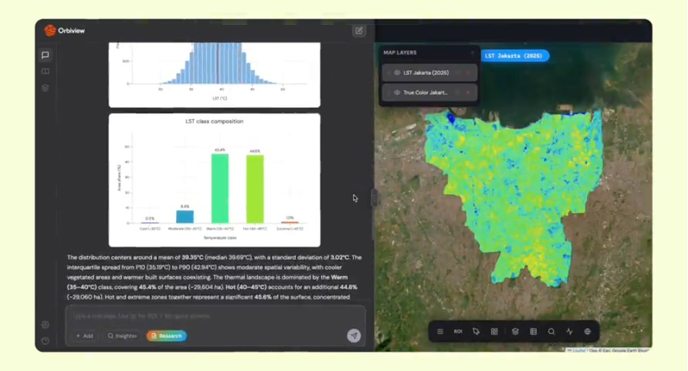
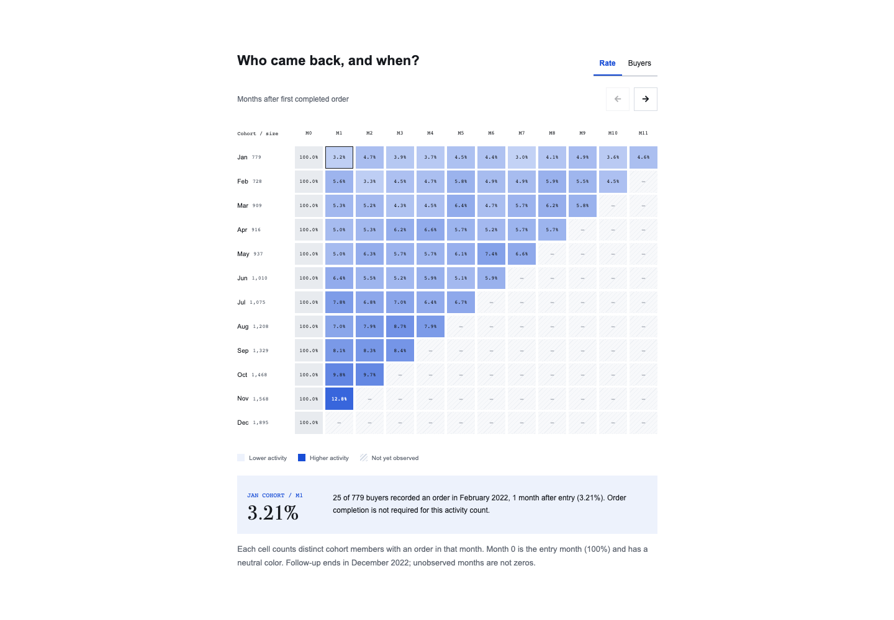
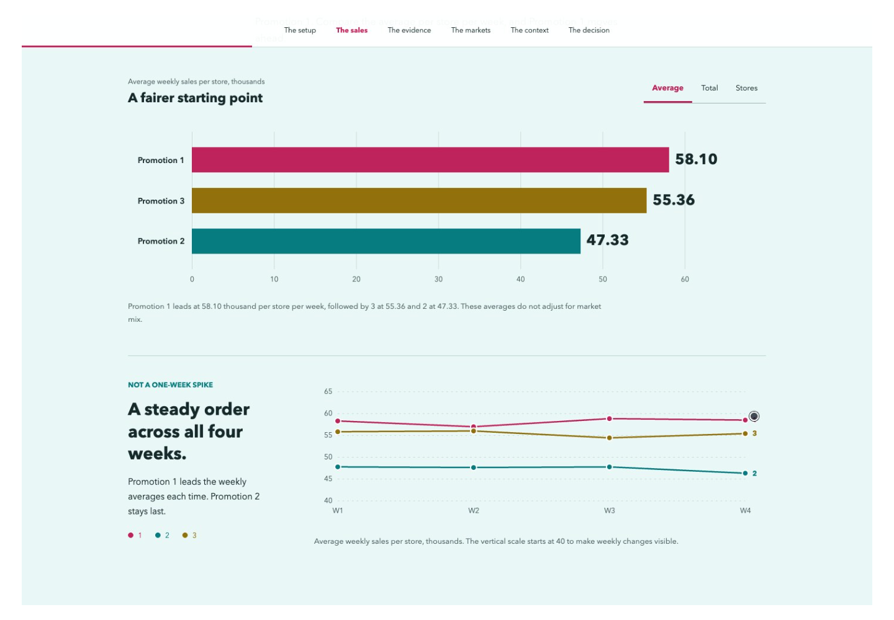
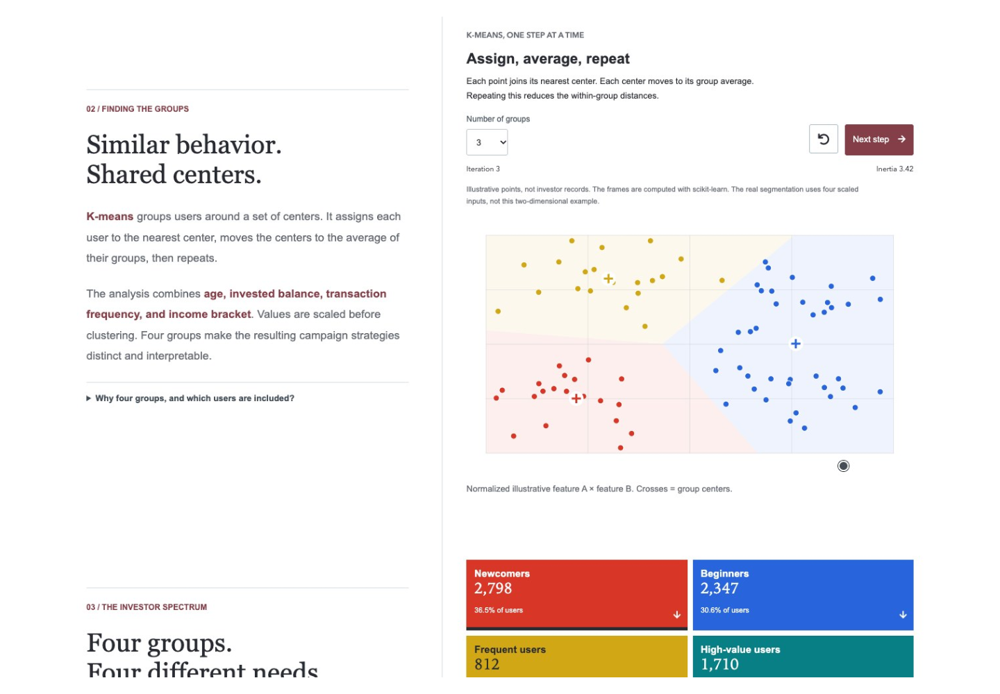
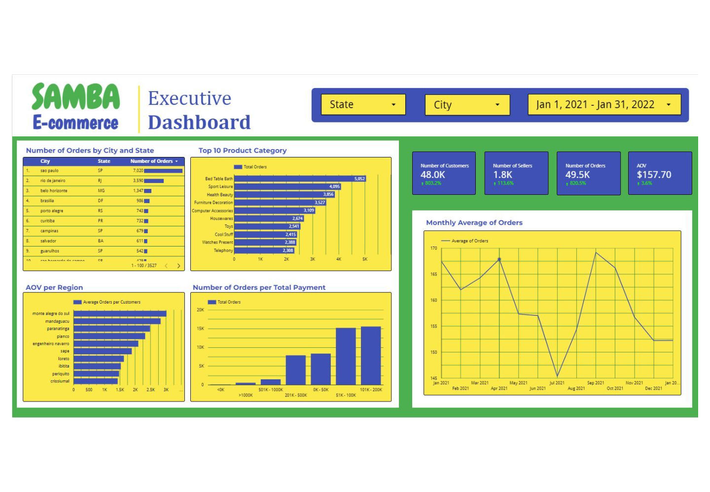
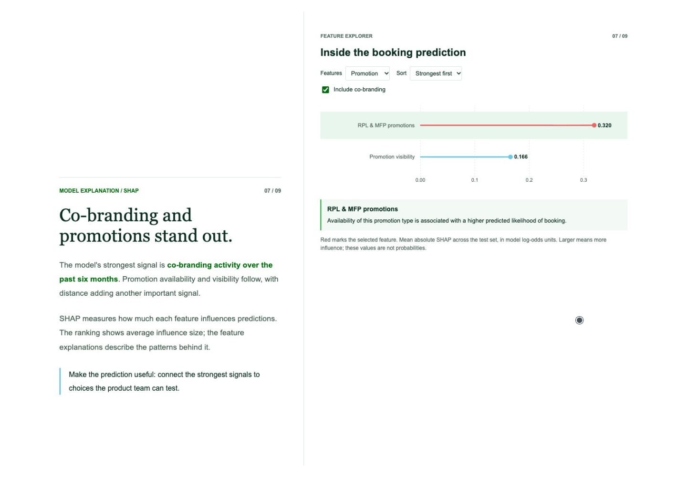
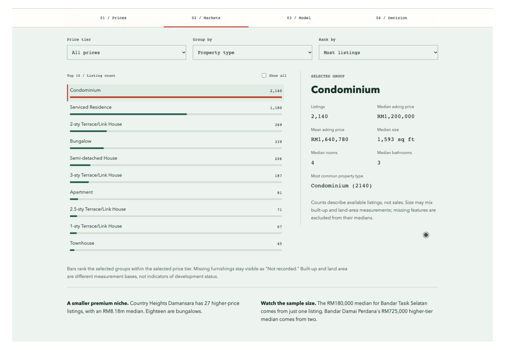

# Rafiq Naufal Kastara

### Data Scientist · Data Analyst · AI Builder

**I turn complex data into clear decisions and practical tools.**

My work connects data preparation, business intelligence, statistical analysis, machine learning, and geospatial AI. This portfolio brings that work into interactive stories and working applications: explore the evidence, change the inputs, and see how the findings connect to business questions.

**[Explore my portfolio](https://fiqcodes.github.io/DataAnalystPortfolio/) · [Connect on LinkedIn](https://www.linkedin.com/in/rafiqnaufal/) · [Email me](mailto:rafiqnaufal97@gmail.com)**

[](https://fiqcodes.github.io/DataAnalystPortfolio/)

<p align="center">
  
  
  
  
  
  
  
  
</p>

## What I Bring

- **Business-focused analysis:** investigate conversion, retention, churn, campaign performance, and pricing, then explain what the evidence supports.
- **Reliable analytical foundations:** use SQL, Python, dbt, and BI tools to connect analysis-ready data with reporting and decision-making.
- **Explainable machine learning:** combine segmentation and predictive models with interpretation, including XGBoost and SHAP.
- **Practical AI applications:** build agents that turn natural-language questions into SQL, visual insights, and geospatial analysis.
- **Clear communication:** present methods, assumptions, and findings through interactive articles, dashboards, and demos.

## Featured AI Applications

### SmartLook | Ask a Business Question. Explore the Data.

An AI analytics agent that turns natural-language questions into SQL queries and visual insights from e-commerce data. It connects a conversational interface with a structured analysis workflow, helping users move from a question to an answer they can inspect.

**Focus:** AI agents, text-to-SQL, business intelligence, LangGraph, React.

[](https://smartlook-ai-agent.vercel.app/)

**[Launch SmartLook](https://smartlook-ai-agent.vercel.app/) · [Explore the source](https://github.com/fiqcodes/smartlook-ai-agent)**

### Orbiview | Explore Environmental Change With AI

A geospatial AI agent for exploring satellite imagery, interactive maps, and research reports through natural-language questions. Investigate vegetation, urban heat, and land-cover change across locations and years.

**Focus:** Python, LangGraph, Google Earth Engine, Leaflet, geospatial analysis.

[](https://gis-ai-agent.vercel.app/)

**[Launch Orbiview](https://gis-ai-agent.vercel.app/) · [Explore the source](https://github.com/fiqcodes/gis-ai-agent)**

## Analytics & Machine Learning Case Studies

Each case study is an interactive web article with visual evidence and analysis, not just a static project summary.

| Project | Business Question | Methods & Tools | Explore |
| --- | --- | --- | --- |
| **Customer Conversion Prediction** | What makes a customer place an order, and which signals help explain conversion? | Python, XGBoost, SHAP, cohort analysis | [Case study](https://fiqcodes.github.io/DataAnalystPortfolio/projects/lalafood/) |
| **User Retention & Product Growth** | Who comes back, and which product categories contribute to growth? | SQL, BigQuery, cohort analysis, profit-growth comparison | [Case study](https://fiqcodes.github.io/DataAnalystPortfolio/projects/thelook/) |
| **User Segmentation & Churn Prediction** | How can investor behavior and churn risk inform a targeted campaign? | Python, K-Means, logistic regression, benefit-cost analysis | [Case study](https://fiqcodes.github.io/DataAnalystPortfolio/projects/segmentation/) |
| **Campaign Effectiveness & A/B Testing** | Which promotion performs better, and how convincing is the evidence? | Spreadsheets, exploratory analysis, statistical testing | [Case study](https://fiqcodes.github.io/DataAnalystPortfolio/projects/campaign/) |
| **Property Price Analysis & Regression** | Which property features help explain prices and reveal opportunities? | Spreadsheets, exploratory analysis, regression | [Case study](https://fiqcodes.github.io/DataAnalystPortfolio/projects/abc/) |
| **Samba E-commerce Performance** | How are sales, customers, and operational performance evolving? | Tableau, Looker Studio, dashboard analysis | [Case study](https://fiqcodes.github.io/DataAnalystPortfolio/projects/samba/) |

### A Closer Look

<table>
  <tr>
    <td width="50%" valign="top"><a href="https://fiqcodes.github.io/DataAnalystPortfolio/projects/thelook/"></a><br><strong>Retention & product growth</strong><br>Connect customer behavior with commercial priorities.</td>
    <td width="50%" valign="top"><a href="https://fiqcodes.github.io/DataAnalystPortfolio/projects/campaign/"></a><br><strong>Campaign effectiveness</strong><br>Separate promising results from meaningful differences.</td>
  </tr>
  <tr>
    <td width="50%" valign="top"><a href="https://fiqcodes.github.io/DataAnalystPortfolio/projects/segmentation/"></a><br><strong>Segmentation & churn</strong><br>Translate behavioral patterns into targeting decisions.</td>
    <td width="50%" valign="top"><a href="https://fiqcodes.github.io/DataAnalystPortfolio/projects/samba/"></a><br><strong>Executive dashboards</strong><br>Bring business performance into one clear view.</td>
  </tr>
  <tr>
    <td width="50%" valign="top"><a href="https://fiqcodes.github.io/DataAnalystPortfolio/projects/lalafood/"></a><br><strong>Customer conversion</strong><br>Explain the signals behind a customer's decision to order.</td>
    <td width="50%" valign="top"><a href="https://fiqcodes.github.io/DataAnalystPortfolio/projects/abc/"></a><br><strong>Property pricing</strong><br>Explore the features behind prices and potential opportunities.</td>
  </tr>
</table>

**See the projects in action:** the [portfolio gallery](https://fiqcodes.github.io/DataAnalystPortfolio/#projects) includes video demos of both AI applications and guided tours of all six case studies.

## Skills & Toolkit

| Area | Tools & Approaches |
| --- | --- |
| Data warehousing | SQL, dbt, BigQuery, Trino, data modeling |
| Business intelligence | Tableau, Looker Studio, Apache Superset, KPI reporting |
| Data science | Python, pandas, scikit-learn, regression, K-Means, XGBoost, SHAP |
| Experimentation & growth | A/B testing, cohort analysis, retention, segmentation |
| AI & agents | LangGraph, retrieval-augmented generation, LLMs, text-to-SQL |
| Data engineering | Python, SQL, Apache Airflow, ETL/ELT pipelines |
| Geospatial analytics | GIS, Google Earth Engine, spatial analysis, interactive mapping |

## About This Portfolio

The site pairs a retro desktop-inspired design with working project demos: pixel-style headings, colorful section backgrounds, an animated runner, and a certificate gallery. The homepage is responsive and includes reduced-motion handling, keyboard-accessible controls, and new-tab project links.

This repository hosts the **static portfolio and case-study articles**. SmartLook and Orbiview are separate applications with their own repositories and deployments.

### Browse Locally

Open `index.html` in a browser. No package installation or build step is required to view the portfolio.

```text
index.html                 Portfolio homepage
projects/                  Six interactive case-study articles
assets/home/               Homepage styling, scripts, fonts, and media
assets/home/demos/         Project videos and preview screenshots
assets/home/certificates/  Certificate images and PDFs
showcase/                  Portfolio showcase thumbnail
scripts/                   Content builders and verification tools
```

## Let's Connect

Interested in discussing data science, analytics, business intelligence, or AI-powered tools?

**[LinkedIn](https://www.linkedin.com/in/rafiqnaufal/) · [GitHub](https://github.com/fiqcodes) · [rafiqnaufal97@gmail.com](mailto:rafiqnaufal97@gmail.com)**

## Credits & Attribution

- Original template foundation: [Landed by HTML5 UP](https://html5up.net/landed), by AJ, under [Creative Commons Attribution 3.0](https://html5up.net/license). The current homepage and case-study experiences have been customized.
- Icons: [Font Awesome](https://fontawesome.com/). Technology badges: [Shields.io](https://shields.io/).
- Runner artwork: The Chromium Authors. See [asset provenance](assets/home/CHROMIUM-ASSETS.md) and the [BSD license](assets/home/CHROMIUM-LICENSE.txt).
- Anonymous Pro font: see its [Open Font License](assets/home/AnonymousPro-OFL.txt).
- Project demo sources and recording details: [demo documentation](assets/home/demos/README.md).
- Legacy template resources include Unsplash imagery, jQuery, Scrollex, and Responsive Tools; retained third-party resources remain subject to their original licenses.
